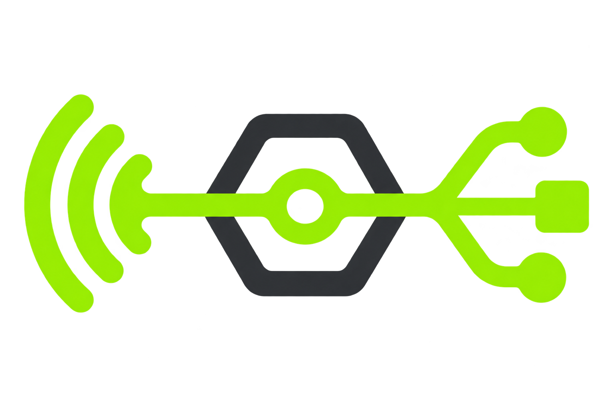
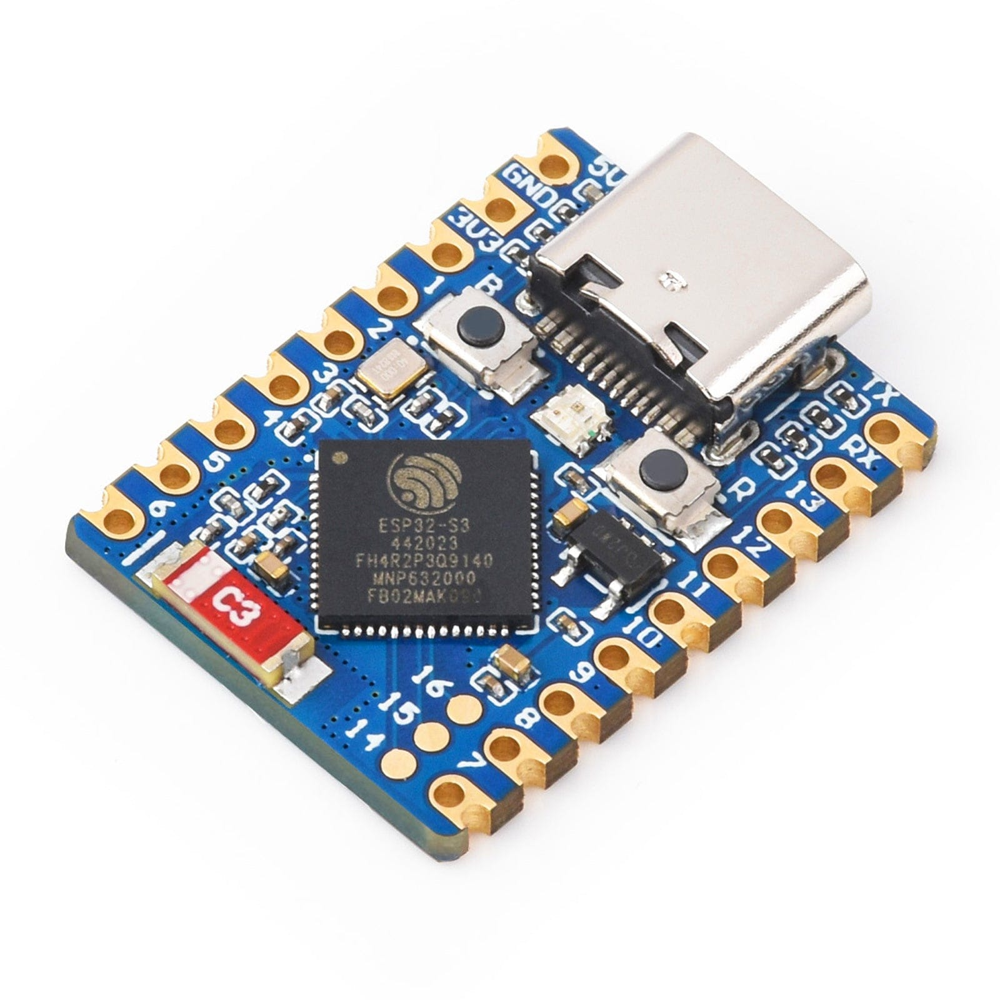
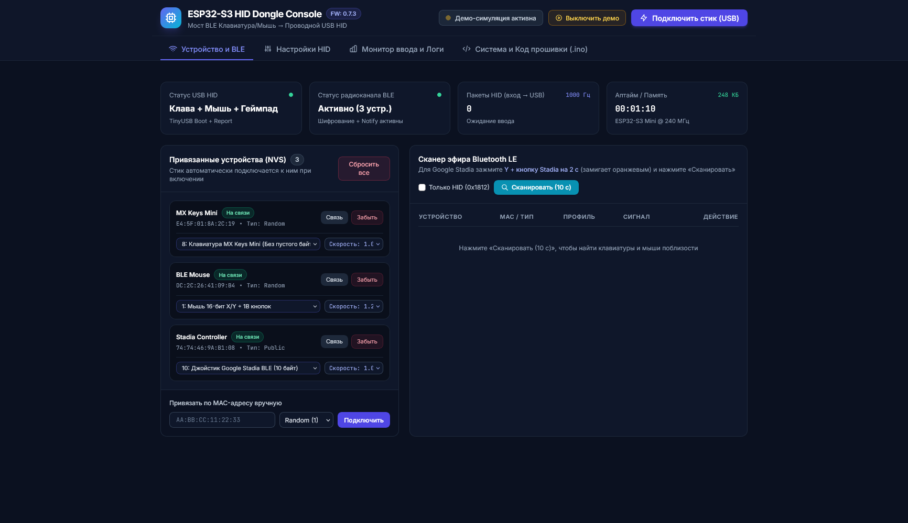

<div align="center">

### 🌐 Language
[English](README.md) • [Русский (Russian)](README.ru.md)



# ESP32 BLE Bridge

**Universal bridge between BLE keyboard and USB computer**

> Convert your BLE keyboard to your computer as a regular USB HID device.
> No drivers, no software, no hassle. 🎯

**[🌐 Open Web Console](https://vector-co-uz.github.io/esp32s3-blebridge/web/web_console.html)** — start configuration right now!

An ESP32-S3 based adapter that connects to BLE HID devices and transmits their input to a computer as a wired USB device.

[](https://www.espressif.com/en/products/socs/esp32-s3)
[](https://en.wikipedia.org/wiki/Human_interface_device)
[](https://github.com/espressif/arduino-esp32)
[](LICENSE)
[](https://claude.ai)

</div>

---

## About the Project

```
BLE keyboard/mouse → ESP32-S3 → USB HID → Computer
```

In home infrastructure, there are often multiple servers managed remotely. But when network outages, boot issues, or BIOS access is needed, you have to connect a wired keyboard or carry a separate receiver between computers.

**ESP32 BLE Bridge** solves this problem: a small USB adapter that looks like a regular wired USB HID device to the computer, but receives input from a Bluetooth keyboard and mouse. No driver installation, no software — just plug it in and it works.

Inspired by [Logi Bolt](https://www.logitech.com/en-us/products/universal-receivers/logi-bolt-usb-receiver.910-006361.html), but with support for **any** BLE devices that follow the HID standard.

---

## ✨ Features

- 📱 **BLE Keyboard and Mouse Support** — standard HID devices
- 🎮 **Experimental Gamepad Support** — Google Stadia Controller
- 💾 **Save up to 5 Devices** — quick reconnection
- 🔄 **Automatic Reconnection** — on connection loss
- ⚙️ **Browser Configuration** — WebSerial console, no app installation
- 🌈 **Status Indication** — RGB WS2812 LED on GPIO 21
- 🔌 **USB OTA Updates** — update firmware via USB

---

## 📊 Hardware

### ESP32-S3 Zero Mini



**Specifications:**
- ⚡ **Super Compact** — coin-sized
- Native USB-C (USB-OTG + HID)
- Bluetooth 5.3 LE
- Dual-core 240 MHz
- 8 MB PSRAM + 8 MB Flash
- GPIO 21: WS2812 LED (status indicator)
- Perfect for portable adapters

**Required Versions:**
| Component | Version |
|-----------|---------|
| **Arduino Core** | 3.3.x or higher |
| **NimBLE-Arduino** | 2.5.x or higher |

---

## 🚀 Quick Start

### Step 1: Prepare Arduino IDE

1. Open Arduino IDE
2. **File** → **Preferences** (or **Arduino** → **Settings** on Mac)
3. In the **Additional Boards Manager URLs** field, add:
   ```
   https://raw.githubusercontent.com/espressif/arduino-esp32/gh-pages/package_esp32_index.json
   ```
4. Click OK

### Step 2: Install ESP32 Core and Libraries

1. **Tools** → **Board** → **Boards Manager**
2. Search for `esp32` and install version **3.3.x** from Espressif
3. **Sketch** → **Include Library** → **Manage Libraries**
4. Search for `NimBLE-Arduino` and install version **2.5.x** or higher

### Step 3: Choose Board Settings

1. **Tools** → **Board** → **ESP32S3 Dev Module**
2. Settings:

| Parameter | Value |
|-----------|-------|
| **Board** | ESP32S3 Dev Module |
| **USB Mode** | USB-OTG (TinyUSB) |
| **USB CDC On Boot** | Enabled |
| **Flash Size** | 16 MB (or 8 MB) |
| **Partition Scheme** | Huge APP (3MB No OTA) or Scheme with OTA |

### Step 4: Upload Firmware

1. Open `esp32_s3_ble_bridge/esp32_s3_ble_bridge.ino`
2. **Sketch** → **Verify** (syntax check)
3. Connect ESP32-S3 via USB-C cable
4. **Tools** → **Port** → select COM port
5. **Sketch** → **Upload** (takes ~2-3 minutes)

### Step 5: Open Web Console

1. Open `web/web_console.html` in Chrome or Edge
2. Click **Connect** and select USB port
3. Console ready! 🎉

---

## 🌐 [Web Console](https://vector-co-uz.github.io/esp32s3-blebridge/web/web_console.html)

Built-in web management console via **WebSerial API** to control the adapter directly from your browser (Chrome, Edge, Brave).

**Features:**
- 🎯 BLE device discovery and pairing
- 📱 Manage saved devices (up to 5)
- 📊 Monitor connection and battery
- 🎛️ Configure mouse sensitivity and HID modes
- 📜 Command and error logging
- 🎮 Demo mode for testing
- 🚀 OTA firmware updates


<div align="center" style="margin: 30px 0;">

Interface Screenshot:

<a href="/pic/web_console.png" title="Click to enlarge">

</a>

</div>

---

## 💡 Use Cases

### Server Without Network Access
```
MacBook (local network)  ──→  Proxmox server  ←──  ESP32 BLE Bridge
                              (no network)        ↑
                                                  Logitech MX Keys
```

### Home Infrastructure with One Keyboard
```
Logitech MX Keys Mini (BLE)
        │
        ├─→ ESP32 Bridge on Desktop      [USB-A]
        ├─→ ESP32 Bridge on MacBook      [USB-C]
        └─→ ESP32 Bridge on Proxmox      [USB inside]

Just switch the adapter between ports!
```

---

## 📋 Supported Devices

The project works with **any** standard BLE HID devices:

✅ **Keyboards**
- Logitech MX Keys Mini, MX Keys
- Apple Magic Keyboard
- Keychron K2, K3, K4, K8, K10
- Microsoft Modern Keyboard
- Most BLE keyboards with standard HID support

✅ **Mice**
- Logitech MX Master 3, MX Anywhere 3
- Apple Magic Mouse
- Microsoft Arc Mouse
- Universal BLE mouse support

⚠️ **Experimental**
- Google Stadia Controller (partial support)
- Other gamepads (require profiles)

---

## 📊 Project Status

🚀 **Project is actively developed and used in production.**

**Current Status:** Experimental, but stable for daily use.

**What Works Well:**
- ✅ Standard BLE keyboards
- ✅ BLE mice with basic functions
- ✅ Automatic reconnection
- ✅ WebSerial console and management
- ✅ USB OTA updates

**Known Limitations:**
- ⚠️ Some special keys may require additional profiles
- ⚠️ Gamepad support is experimental
- ⚠️ Maximum 5 saved devices (NVRAM limitation)

**Development History:**
The project stems from real necessity and evolves daily. Right now I'm writing code and communicating with AI through an ESP32 S3 BLE Bridge connected to a **Logitech MX Keys Mini**. New features and bug fixes appear as they're needed in real usage.

---

## 🙏 Credits

**ESP32 BLE Bridge** was inspired by and inherits key ideas from the excellent project [finger563/esp-usb-ble-hid](https://github.com/finger563/esp-usb-ble-hid).

Thanks for the work on:
- 🔌 BLE HID and USB HID architecture
- 🎯 TinyUSB integration with NimBLE
- 🌐 Web console for browser management

---

## 🤖 About Development

I'm a **vibe coder**: all code in this project is written and refined with modern AI assistants.

**Development Team:**
- 🧠 **Claude** (Anthropic) — core logic, architecture, optimization
- 🤖 **Gemini Argon** (Google) — auxiliary solutions, ideas
- 💬 **ChatGPT Sol** (OpenAI) — debugging, documentation

**Process:**
1. 📝 I formulate the task and requirements
2. 🤖 AI generates code and implementation
3. 🧪 I test on real hardware
4. 🔄 I direct further development and refinements
5. ✅ Result — fully functional firmware

This approach enables rapid iteration, adding new features and fixing bugs as they appear in real-world use.

---

## 📄 License

[Apache License 2.0](LICENSE) — use freely in personal and commercial projects.

---

<div align="center">

**Made for those tired of carrying receivers between computers** 🖱️⌨️ ✨

```
BLE Device → Adapter → USB Computer
One keyboard, many servers. One tap.
```

**[🔝 Back to top](#esp32-ble-bridge)**

</div>
