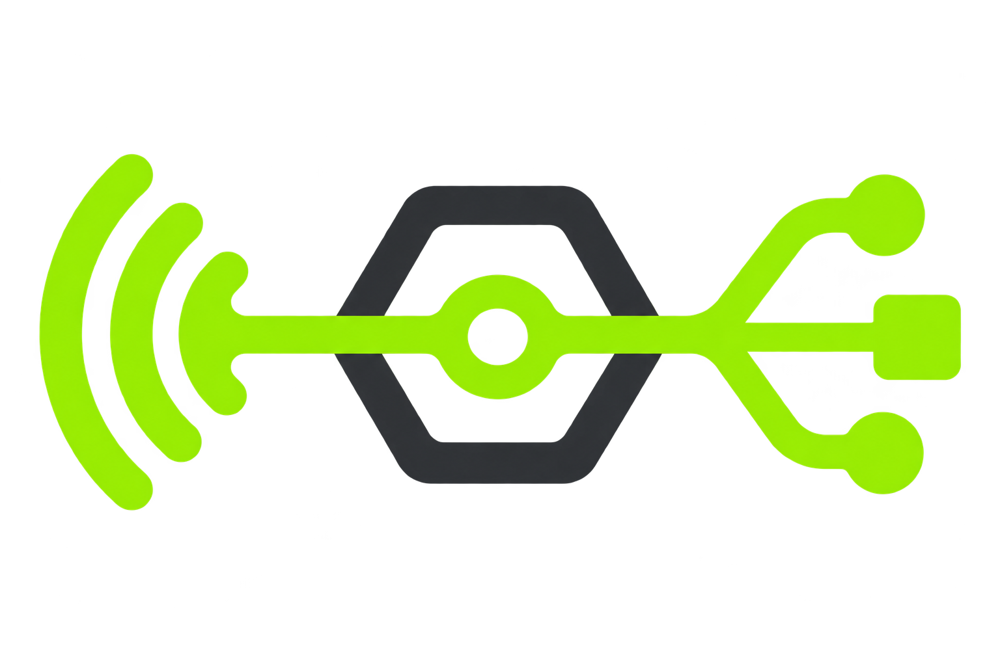
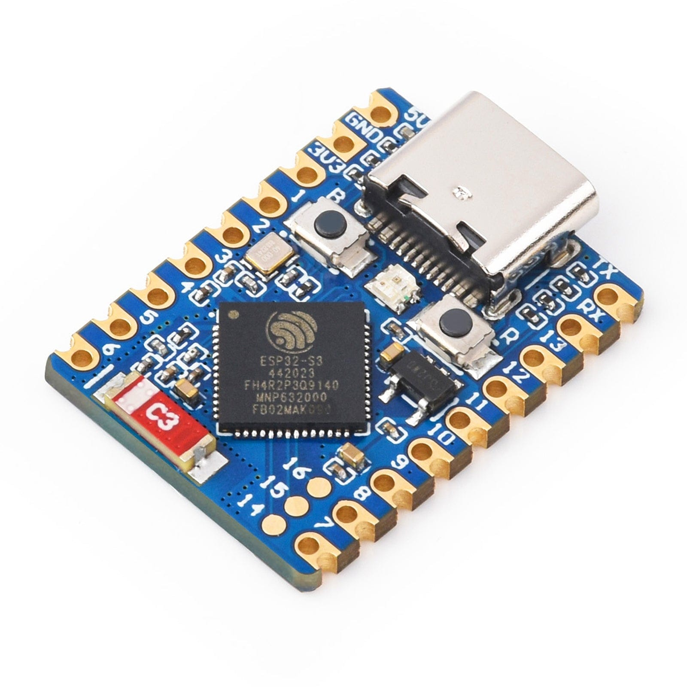
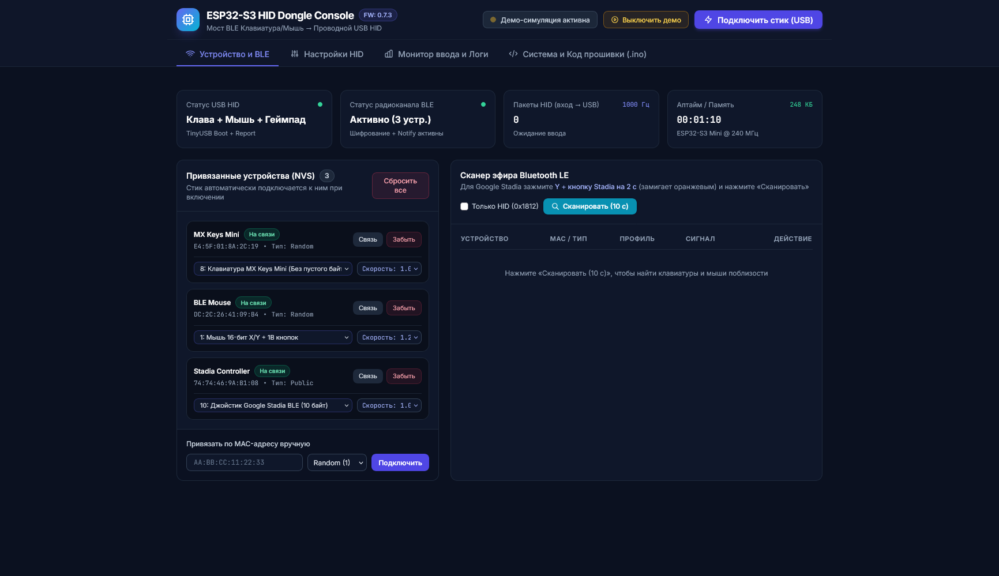

<div align="center">

### 🌐 Язык
[English (Английский)](README.md) • [Русский](README.ru.md)



# ESP32 BLE Bridge

**Универсальный мост между BLE-клавиатурой и USB компьютером**

> Передай свою BLE-клавиатуру компьютеру как обычное USB HID-устройство.
> Никаких драйверов, никакого софта, никаких хлопот. 🎯

**[🌐 Открыть Web Console](https://vector-co-uz.github.io/esp32s3-blebridge/web/web_console.html)** — начните настройку прямо сейчас!

Адаптер на базе ESP32-S3, который подключается к BLE HID-устройствам и передаёт их ввод на компьютер как проводное USB-устройство.

[](https://www.espressif.com/en/products/socs/esp32-s3)
[](https://en.wikipedia.org/wiki/Human_interface_device)
[](https://github.com/espressif/arduino-esp32)
[](LICENSE)
[](https://claude.ai)

</div>

---

## О проекте

```
BLE-клавиатура/мышь → ESP32-S3 → USB HID → Компьютер
```

В домашней инфраструктуре часто есть несколько серверов, которыми управляют удалённо. Но когда случаются сбои сети, проблемы с загрузкой или требуется доступ в BIOS, приходится подключать проводную клавиатуру или таскать отдельный ресивер между компьютерами.

**ESP32 BLE Bridge** решает эту проблему: небольшой USB-адаптер, который выглядит для компьютера как обычное проводное USB HID-устройство, но получает ввод от Bluetooth-клавиатуры и мыши. Без установки драйверов, без софта — просто воткнул в USB и работает.

Вдохновлено идеей [Logi Bolt](https://www.logitech.com/en-us/products/universal-receivers/logi-bolt-usb-receiver.910-006361.html), но с поддержкой **любых** BLE-устройств, которые следуют стандарту HID.

---

## ✨ Возможности

- 📱 **Поддержка BLE-клавиатур и мышей** — стандартные HID-устройства
- 🎮 **Экспериментальная поддержка геймпадов** — Google Stadia Controller
- 💾 **Сохранение до 5 устройств** — быстрое переподключение
- 🔄 **Автоматическое переподключение** — при потере связи
- ⚙️ **Настройка через браузер** — WebSerial-консоль, без установки приложений
- 🌈 **Индикация состояния** — RGB WS2812 LED на GPIO 21
- 🔌 **USB OTA-обновление** — обновляйте прошивку через USB

---

## 📊 Оборудование

### ESP32-S3 Zero Mini



**Характеристики:**
- ⚡ **Супер-компактная** — размером с монету
- Native USB-C (USB-OTG + HID)
- Bluetooth 5.3 LE
- Dual-core 240 MHz
- 8 MB PSRAM + 8 MB Flash
- GPIO 21: WS2812 LED (индикация)
- Идеально подходит для портативных адаптеров

**Требуемые версии:**
| Компонент | Версия |
|-----------|--------|
| **Arduino Core** | 3.3.x или выше |
| **NimBLE-Arduino** | 2.5.x или выше |

---

## 🚀 Быстрый старт

### Шаг 1: Подготовка Arduino IDE

1. Откройте Arduino IDE
2. **File** → **Preferences** (или **Arduino** → **Settings** на Mac)
3. В поле **Additional Boards Manager URLs** добавьте:
   ```
   https://raw.githubusercontent.com/espressif/arduino-esp32/gh-pages/package_esp32_index.json
   ```
4. Нажмите OK

### Шаг 2: Установка ESP32 Core и библиотек

1. **Tools** → **Board** → **Boards Manager**
2. Ищите `esp32` и установите версию **3.3.x** от Espressif
3. **Sketch** → **Include Library** → **Manage Libraries**
4. Ищите `NimBLE-Arduino` и установите версию **2.5.x** или выше

### Шаг 3: Выбор параметров платы

1. **Tools** → **Board** → **ESP32S3 Dev Module**
2. Параметры:

| Параметр | Значение |
|----------|----------|
| **Board** | ESP32S3 Dev Module |
| **USB Mode** | USB-OTG (TinyUSB) |
| **USB CDC On Boot** | Enabled |
| **Flash Size** | 16 MB (или 8 MB) |
| **Partition Scheme** | Huge APP (3MB No OTA) или Scheme with OTA |

### Шаг 4: Загрузка прошивки

1. Откройте файл `esp32_s3_ble_bridge/esp32_s3_ble_bridge.ino`
2. **Sketch** → **Verify** (проверка синтаксиса)
3. Подключите ESP32-S3 через USB-C кабель
4. **Tools** → **Port** → выберите COM-порт
5. **Sketch** → **Upload** (загрузка ~2-3 минуты)

### Шаг 5: Открытие Web Console

1. Откройте в Chrome или Edge файл `web/web_console.html`
2. Нажмите **Connect** и выберите USB-порт
3. Консоль готова! 🎉

---

## 🌐 [Web Console](https://vector-co-uz.github.io/esp32s3-blebridge/web/web_console.html)

Встроенная веб-консоль управления через **WebSerial API** для управления адаптером прямо из браузера (Chrome, Edge, Brave).

**Функции:**
- 🎯 Поиск и сопряжение BLE-устройств
- 📱 Управление сохранённых устройств (до 5 шт)
- 📊 Мониторинг подключения и батареи
- 🎛️ Настройка чувствительности мыши и режимов HID
- 📜 Логирование команд и ошибок
- 🎮 Демо-режим для тестирования
- 🚀 OTA-обновление прошивки


<div align="center" style="margin: 30px 0;">

Скриншот интерфейса:

<a href="/pic/web_console.png" title="Нажмите для увеличения">

</a>

</div>

---

## 💡 Сценарии использования

### Сервер без сетевого доступа
```
MacBook (локальная сеть)  ──→  Proxmox сервер  ←──  ESP32 BLE Bridge
                                 (выключен сеть)     ↑
                                                     Logitech MX Keys
```

### Домашняя инфраструктура с одной клавиатурой
```
Logitech MX Keys Mini (BLE)
        │
        ├─→ ESP32 Bridge на Desktop      [USB-A]
        ├─→ ESP32 Bridge на MacBook      [USB-C]
        └─→ ESP32 Bridge на Proxmox      [USB внутри]

Просто переключай адаптер между портами!
```

---

## 📋 Поддерживаемые устройства

Проект работает с **любыми** стандартными BLE HID-устройствами:

✅ **Клавиатуры**
- Logitech MX Keys Mini, MX Keys
- Apple Magic Keyboard
- Keychron K2, K3, K4, K8, K10
- Microsoft Modern Keyboard
- Большинство BLE-клавиатур с поддержкой стандартного HID

✅ **Мыши**
- Logitech MX Master 3, MX Anywhere 3
- Apple Magic Mouse
- Microsoft Arc Mouse
- Универсальная поддержка BLE-мышей

⚠️ **Экспериментально**
- Google Stadia Controller (частичная поддержка)
- Другие геймпады (требуют профилей)

---

## 📊 Статус проекта

🚀 **Проект активно разрабатывается и используется в реальной работе.**

**Текущее состояние:** Экспериментальное, но стабильное для повседневного использования.

**Что работает отлично:**
- ✅ Стандартные BLE-клавиатуры
- ✅ BLE-мыши с базовыми функциями
- ✅ Автоматическое переподключение
- ✅ WebSerial-консоль и управление
- ✅ USB OTA-обновление

**Известные ограничения:**
- ⚠️ Некоторые специальные клавиши могут требовать дополнительных профилей
- ⚠️ Поддержка геймпадов экспериментальна
- ⚠️ Максимум 5 сохранённых устройств (ограничение NVRAM)

**История развития:**
Проект рождается из реальной необходимости и развивается ежедневно. Прямо сейчас я пишу код и общаюсь с ИИ через ESP32 S3 BLE Bridge, подключённый к **Logitech MX Keys Mini**. Новые возможности и исправления появляются по мере использования.

---

## 🙏 Благодарности

Проект **ESP32 BLE Bridge** был вдохновлён и наследует ключевые идеи из отличного проекта [finger563/esp-usb-ble-hid](https://github.com/finger563/esp-usb-ble-hid).

Спасибо за работу над:
- 🔌 Архитектурой BLE HID и USB HID
- 🎯 Интеграцией TinyUSB с NimBLE
- 🌐 Веб-консолью для управления через браузер

---

## 🤖 О разработке

Я **вайб-кодер**: весь код этого проекта написан и доработан с помощью современных ИИ-ассистентов.

**Команда разработки:**
- 🧠 **Claude** (Anthropic) — основная логика, архитектура, оптимизация
- 🤖 **Gemini Argon** (Google) — вспомогательные решения, идеи
- 💬 **ChatGPT Sol** (OpenAI) — отладка, документация

**Процесс:**
1. 📝 Я формулирую задачу и требования
2. 🤖 ИИ генерирует код и реализацию
3. 🧪 Я тестирую на реальном оборудовании
4. 🔄 Я направляю дальнейшую разработку и доработки
5. ✅ Результат — полнофункциональная прошивка

Такой подход позволяет быстро итерировать, добавлять новые функции и фиксить баги по мере их появления в реальном использовании.

---

## 📄 Лицензия

[Apache License 2.0](LICENSE) — используйте свободно в личных и коммерческих проектах.

---

<div align="center">

**Создано для тех, кто устал таскать ресиверы между компьютерами** 🖱️⌨️ ✨

```
BLE Device → Adapter → USB Computer
One keyboard, many servers. One tap.
```

**[🔝 Вернуться наверх](#esp32-ble-bridge)**

</div>
